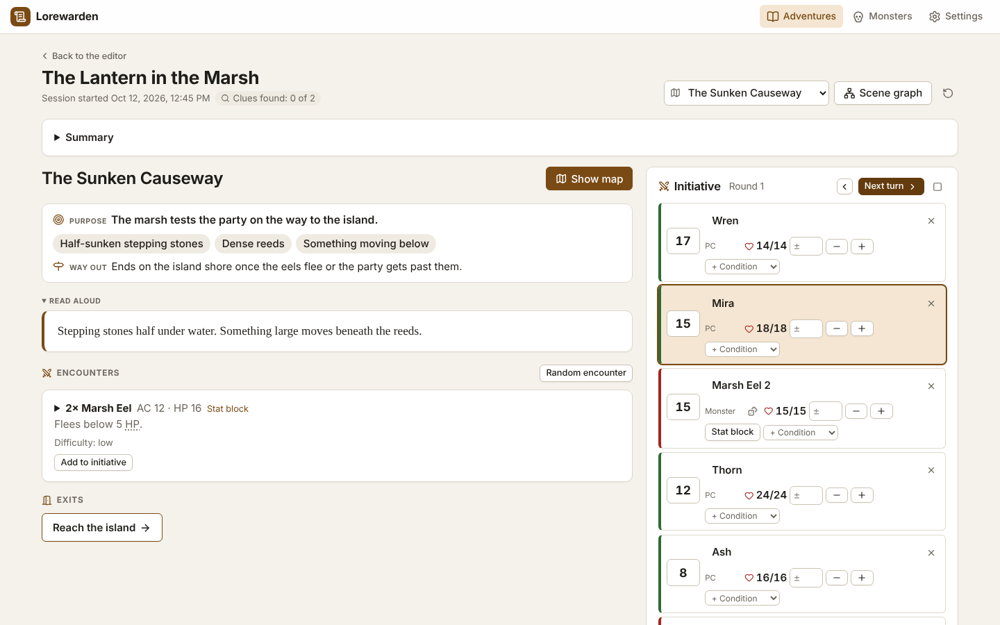
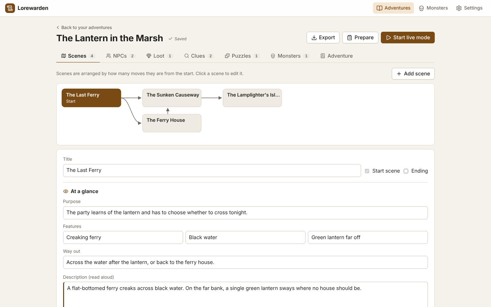
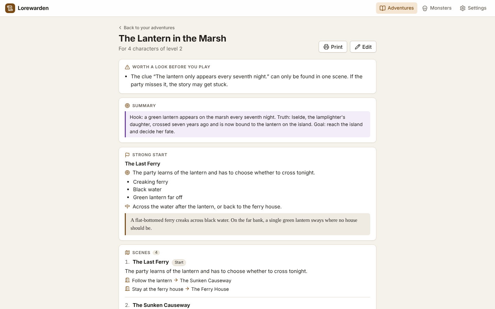
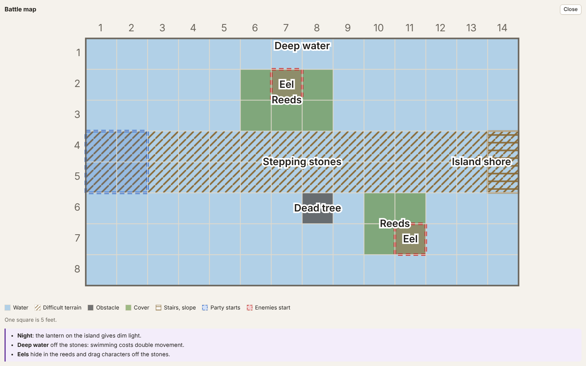

# Lorewarden

A local-first toolkit for game masters of 5e-compatible tabletop RPGs: prepare your story, find the right thing at the table in one or two clicks, and react to your players.

> **Status:** early development. Lorewarden is ready to prepare and run short adventures, but the adventure file format and the interface may still change between releases. Ideas and planned work are tracked in the [issues](https://github.com/mLampir/lorewarden/issues).



## Principles

- **Game master first.** The player side is an extra, never a requirement.
- **Fast at the table.** Everything in live mode is one or two clicks away.
- **Local-first.** Your adventures stay on your computer as JSON files. No account, no cloud; hosting it on your own server is optional.
- **No autopilot.** AI helps with improvisation and names; the game master decides.
- **Only openly licensed content.** Rules content comes from the SRD under CC BY 4.0. Anything else you type in or import yourself.

## Features

### Prepare

- **Adventure library:** create adventures, import and export them as JSON, load the example adventure.
- **Scene graph editor:** scenes with read-aloud text, private notes, NPCs, loot and exits. The graph shows how scenes connect and flags scenes the party cannot reach.
- **Scenes at a glance:** give a scene its purpose, up to three features and a way out, and live mode shows them on top so you find your footing in a second. Notes take bullet points and **bold** key words; read-aloud text and notes fold away.
- **NPC and loot cards:** write them once, give NPCs a voice note for how to play them and place them in any number of scenes.
- **Clues:** the truths the party should find out, as reminders for you, each with a few ways to find it (a witness, a trace, an object) tied to the scene where it turns up or the NPC who knows it. Live mode shows each way where it turns up: traces and objects under "To discover here" in the scene, what an NPC can give away on their card, each with the truth it leads to. Tick off what the party has found in either place.
- **Encounter generator:** pick a difficulty and, if you like, a creature type, and Lorewarden puts together a fight that fits the party by the SRD 5.2 XP budget, from the SRD monsters and your own. Add it to a scene in the editor, or roll one up in live mode when the players go somewhere you did not plan for. Change the number of monsters and see right away how hard the fight is.
- **Review before you play:** dead ends, clues that are easy to miss or have no ways to find them, puzzles without a solution or hints, encounters whose XP no longer fit the party (SRD 5.2 budget), and boss fights without any mechanic.
- **Prep sheet:** the whole adventure on one page to read before the session or print: summary, the start scene, every scene in one line with its exits, clues, NPCs with their voices, fights with AC, HP and CR, and puzzles with their solutions. Open review hints are on top; from there you start a new session or continue the last one.
- **Create and adapt with an AI assistant:** the app copies instructions for an assistant such as Claude and imports its answer, in the language you choose. Duplicate an adventure for another party size or level, or add the characters once you know them, and have the adventure fitted to the party the same way.

<p>
  
  
</p>

### At the table

- **Live mode:** the current scene with its exits as buttons, loot and encounters; jump to any scene or open the scene graph. Next to the scene, a side column with tabs shows the scene's NPCs, the initiative, the players and the session log one at a time, so you read the scene and an NPC side by side; a click on a name at the top of the scene opens that NPC, and the initiative comes up when a fight starts.
- **Battle maps:** the AI assistant sketches a grid map for every scene with a fight (walls, cover, difficult terrain, where everyone starts). Live mode shows it full screen so you can copy it onto a battle mat. You can also upload your own map images.
- **Rules, stat blocks, NPCs and loot on hover:** in live mode and on the prep sheet, rules terms such as *Prone* or *DC*, creature names, NPC names and item names in the adventure text show the rule from the SRD 5.2.1 glossary, the creature's stat block, or the NPC or item card when you point at them or tap them. An NPC is also found by a part of their name, e.g. *Brannoc* for *Old Brannoc*. Rules terms are recognised as the English rulebooks print them; for an adventure in another language, switch on English rules terms.
- **Initiative tracker:** rounds and turns, hit points (type +5 to heal, 5 or -5 for damage), SRD conditions; add an encounter's monsters or a scene's NPCs with one click. Monsters arrive with their hit points and roll initiative as they join, or keep the initiative score from the stat block if you turn the rolls off. Groups of monsters roll their hit points from the hit dice, so they differ; a single monster keeps the average. Player characters stay for the whole session. When combat starts, players enter their initiative on their phones and it is sorted in right away; you see who is still missing.
- **Individual monsters and boss mechanics:** give monsters of an encounter a name, a few words to narrate and their own hit points, e.g. a goblin leader next to three goblins. Boss fights and climaxes get mechanics such as phases, a countdown or crystals that shield the boss: the initiative tracker reminds you when a trigger fires, and destructible objects join it without a turn. The AI assistant writes both where they add something.
- **Session log:** scene changes are logged automatically, add notes in one line, export the log as Markdown.



### Players

- **Players at the table:** players join with their phones by scanning a QR code; no app and no account needed. Show handouts, images, read-aloud text and hints to everyone or to single players, and take them back. Phones need to be in the same Wi-Fi as the game master's computer.
- **Puzzles:** riddles, locks and other puzzles with a picture or SVG drawing, a solution and hints from a gentle nudge to almost the answer. In live mode, show the puzzle on the players' phones and send each hint to everyone or to single players, e.g. one fragment per player. The AI assistant builds puzzles into new adventures and can draw them as SVG.

### Monsters

- **Monster stat blocks:** all 331 monsters of the SRD 5.2.1 are built in. The AI assistant picks its creatures from them, and live mode and the initiative tracker show the full stat block with one click. Rules text stays in English.
- **Your own monsters:** create monsters with a full stat block, copy an SRD monster and change it, or let an AI assistant write one. They are kept next to the SRD monsters, every adventure can use them, and the AI assistant knows them. Creatures an AI invents for an adventure get a full stat block too; save them to your monsters with one click. An exported adventure carries the stat blocks it needs.

The app is in English and German, and follows your system's light or dark mode.

Not planned: character sheets and dice rollers (players keep using their own tools, e.g. D&D Beyond), map editors, a complete virtual tabletop and rules automation. Ideas for what comes next, such as a display for a TV or projector at the table, are collected in the [issues](https://github.com/mLampir/lorewarden/issues?q=is%3Aissue+is%3Aopen+label%3Aenhancement).

## Getting started

You need Node.js 22 or newer.

```sh
git clone https://github.com/mLampir/lorewarden.git
cd lorewarden
corepack enable
pnpm install
pnpm start
```

Then open http://localhost:47616. To try it out, load the example adventure from the library.

A small Lorewarden server runs on your computer. It keeps every adventure as a file in the folder `~/Lorewarden` (change it with `--dir` or `LOREWARDEN_DIR`) and your own monsters in `monsters.json` there, serves the game master app to this computer only, and passes on to the phones what you show your players. Back up the folder, or export single adventures to share them.

To show handouts on your players' phones, open live mode and press **Connect phones**. The phones scan the QR code and need to be in the same Wi-Fi. Your operating system may ask whether Node.js may accept connections; allow it for private networks.

To update, run `git pull`, `pnpm install` and `pnpm start` again.

### Hosting it on a server

To run Lorewarden on your own server with Docker, behind a password and HTTPS, see [Hosting Lorewarden yourself](docs/self-hosting.md). The game master app shows when a new release is out.

## Work with an AI assistant (MCP server)

Lorewarden comes with an [MCP](https://modelcontextprotocol.io) server, so an AI assistant such as Claude Desktop can work on your adventures with you, using your own subscription:

- **Build an adventure:** the prompt "New adventure" works through a short adventure with you step by step and saves every step. Bring as much as you already have, such as a plot, NPCs or monsters that should appear; Claude builds on it and skips what you have settled.
- **Change an adventure:** "Make the cellar creepier", "Add a second way into the tower".
- **At the table:** the prompt "What now?" knows the scene you are playing, the session log and the running combat, and suggests three ways to react.
- **Monsters:** the assistant picks SRD monsters and your own monsters that fit your party, and writes a full stat block for a creature it invents, so you have every stat block at the table. Ask it to save a monster to your monsters, and every adventure can use it.

The assistant uses the same Lorewarden server as the app, so everything it changes appears in the app right away. Your adventures stay on your computer; the assistant only sends its provider what it reads while it works with you.

If you host Lorewarden on a server, you can skip the setup below and add it in Claude as a custom connector instead, see [AI assistants](docs/self-hosting.md#ai-assistants).

### Set it up

1. In your copy of Lorewarden (see [Getting started](#getting-started)), build the MCP server:

   ```sh
   pnpm build:mcp
   ```

2. In Claude Desktop open **Settings → Developer → Edit Config** and add Lorewarden to `claude_desktop_config.json`, with the full path to your copy:

   ```json
   {
     "mcpServers": {
       "lorewarden": {
         "command": "node",
         "args": ["/path/to/lorewarden/packages/mcp/dist/lorewarden-mcp.js"]
       }
     }
   }
   ```

3. Restart Claude Desktop and start Lorewarden with `pnpm start`. The AI works on the same adventures as the app, and its changes show up in the open app right away. When Lorewarden is not running, it works on the adventure files directly.

### Update it

In your copy of the repository:

```sh
git pull
pnpm install
pnpm build:mcp
```

Then quit and restart Claude Desktop, so it starts the new MCP server, and restart Lorewarden. The configuration stays as it is.

More options, such as another folder, and the list of tools are in the [server's README](packages/mcp/README.md).

## Repository layout

```
apps/
  dm/          Game master web app (laptop/tablet)
  player/      Player web app (phone)
packages/
  content/     Openly licensed game content: the SRD 5.2.1 monsters and rules glossary
  core/        Data model, validation and rules math (plain TypeScript, no UI)
  mcp/         MCP server for AI assistants such as Claude Desktop
  server/      Lorewarden server: keeps adventures, serves both apps, talks to the phones
docs/          Hosting guide and design guidelines
examples/      Example adventures written for this project
```

## Development

Requirements: Node.js 22 or newer and [pnpm](https://pnpm.io) (`corepack enable` installs the right version).

```sh
pnpm install
pnpm start        # build everything and run Lorewarden on http://localhost:47616
pnpm dev          # Lorewarden server (with a fresh player build) plus the game master app with hot reload on http://localhost:5173
pnpm dev:player   # player app with hot reload on http://localhost:5174/play/
pnpm test
pnpm lint
pnpm typecheck
pnpm check:privacy  # looks for local paths and email addresses in tracked files
pnpm build
```

See [CONTRIBUTING.md](CONTRIBUTING.md) before opening a pull request.

## License

Copyright (C) 2026 Lampir (https://lampir.at)

- **Code:** GNU Affero General Public License, version 3 or (at your option) any later version, see [LICENSE](LICENSE). If you run a modified version as a service for others, you must offer them its source code. The project comes without any warranty.
- **Example adventures** in `examples/`: [CC BY 4.0](examples/LICENSE.md).
- **Rules content:** This work includes material from the System Reference Document 5.2.1 ("SRD 5.2.1") by Wizards of the Coast LLC, available at https://www.dndbeyond.com/srd. The SRD 5.2.1 is licensed under the Creative Commons Attribution 4.0 International License, available at https://creativecommons.org/licenses/by/4.0/legalcode. The monster stat blocks in `packages/content` were converted from the SRD 5.2 data of the [Open5e](https://open5e.com) project, and the rules glossary from the Markdown version of the [dnd-5e-srd-markdown](https://github.com/downfallx/dnd-5e-srd-markdown) project, see [packages/content/LICENSE.md](packages/content/LICENSE.md).
- **Adventure-building advice** in the instructions for AI assistants: this work includes material taken from the [Lazy GM's Resource Document](https://slyflourish.com/lazy_gm_resource_document.html) by Michael E. Shea of SlyFlourish.com, available under a [Creative Commons Attribution 4.0 International License](https://creativecommons.org/licenses/by/4.0/).
- **Icons** from [Lucide](https://lucide.dev) under the ISC License, see [THIRD-PARTY-NOTICES.md](THIRD-PARTY-NOTICES.md).

Much of the code is created with Claude.

Lorewarden is unofficial fan content and is not affiliated with, endorsed, sponsored or approved by Wizards of the Coast.
